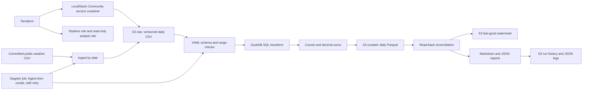

# aws-data-platform-lab

[](https://github.com/hamza2829/aws-data-platform-lab/actions/workflows/ci.yml)

A small cloud data platform defined with Terraform and exercised against LocalStack
Community Edition. A committed public CSV becomes daily S3 raw objects and reconciled
DuckDB/SQL Parquet partitions. A durable watermark makes incremental retry safe.



## Measured results

<!-- RESULTS:START -->
Measurements are pending the first green GitHub Actions run. No numbers are claimed yet.
<!-- RESULTS:END -->

## Run the emulator lab

All development verification is performed exclusively in GitHub Actions. No dependencies
were installed on the user's PC. These commands are for a Linux development environment
or runner with Docker, Terraform 1.11.4, and Python 3.11 already available.

```bash
docker run --rm -d --name data-platform-localstack -p 4566:4566 \
  -e SERVICES=s3,iam,sts localstack/localstack:4.3.0

terraform -chdir=infra init
terraform fmt -check -recursive infra
terraform -chdir=infra validate
terraform -chdir=infra apply -auto-approve

python -m venv .venv
source .venv/bin/activate
pip install -e '.[dev]'

data-platform-lab ingest data/seattle-weather.csv
data-platform-lab run --output runs/manual
data-platform-lab run --output runs/manual
data-platform-lab run --day 2012-01-03 --output runs/manual
data-platform-lab history
data-platform-lab orchestrate data/seattle-weather.csv --output runs/dagster

ruff check .
pytest --cov --cov-report=term-missing
```

The second incremental run is a no-op. `--day` explicitly reprocesses an already
committed day without rewinding the watermark. `--role-arn`, `--prefix`, and `--endpoint`
are global options placed before the subcommand. `--role-arn` assumes the Terraform
pipeline role with local STS credentials; the CI integration uses that path. Python
clients accept only HTTP LocalStack endpoints named localhost, 127.0.0.1, or localstack
on port 4566. Terraform uses hardcoded local endpoints and dummy credentials.

For a fresh drill, use the [failure and recovery guide](docs/failure-drill.md). It must
run before an existing watermark is created. To clean up the emulator resources:

```bash
terraform -chdir=infra destroy -auto-approve
docker stop data-platform-localstack
```

`force_destroy` is enabled for the lab buckets, including their retained versions.
No real AWS account, credentials, or cloud resources are involved. The image is pinned
to the historical community release `localstack/localstack:4.3.0`, with no Pro image
or paid features. It is not a claim about current LocalStack licensing or later images.

## Infrastructure

`infra/` pins Terraform and the AWS provider. It creates raw and curated S3 buckets
with versioning, public access blocks, AES256 default encryption, noncurrent version
expiry after 30 days, and incomplete multipart-upload cleanup after seven days.
Current data objects and the watermark are not expired by these rules. IAM includes
a pipeline role with list/get/put scoped to the two buckets and a read-only analyst
role scoped to curated `weather/*` objects. Role trust names only the emulator account.
The pipeline role cannot administer buckets or IAM, and the analyst policy includes
no write actions. Policies are checked through boto3 after apply. Community emulation
does not establish real AWS IAM enforcement or effective least privilege.

## Data and incremental semantics

The input is a seven-day historical Seattle weather excerpt. See
[data attribution](data/README.md). It has one row per day, so this is deliberately
small data, not a throughput benchmark. There is no live data download during a run.

Raw keys: `weather/date=YYYY-MM-DD/source.csv`.
Curated keys: `weather/date=YYYY-MM-DD/part-00000.parquet`.
State: `_state/watermark.json` in the curated bucket.

Ingestion validates the entire committed source before uploading any daily files.
The exact ordered header, primary-key uniqueness, date format, decimal scale, numeric
ranges, weather categories, and minimum/maximum temperature relation follow the
[YAML contract](src/data_platform_lab/contracts/weather.yaml). A missing, renamed,
additional, or reordered column fails with a clear error. Each raw partition is
validated again before transformation and must contain its declared date.

[DuckDB SQL](src/data_platform_lab/sql/transform.sql) casts dates and exact decimal
types, normalizes weather text, and derives temperature range. Python transfers S3
objects to temporary files; DuckDB reads and writes Parquet without downloading
extensions or using a remote catalog. Rows and sums of precipitation, wind, and both
temperatures must match exactly. Candidate checks run before publication, followed
by reconciliation against the actual S3 read-back. Reports include object version IDs
and raw SHA256 hashes. Failed schema checks show unknown metrics and the failure reason.

The watermark advances one day at a time only after successful reconciliation. A
missing calendar day stops progress instead of silently skipping it. Explicit
reprocessing replaces the same object key, so the current partition has one file and
no duplicate rows; S3 retains prior versions. Raw changes at or before the watermark
require explicit reprocessing. Ingestion is an upsert and can create new raw versions.
If the first available raw object is already late, there is no independent schedule
to infer earlier missing days. This is documented rather than treated as full CDC.

## Monitoring and orchestration

Each attempt has a unique run ID and structured JSON event logs with timestamps,
partition dates, stages, counts, errors, and watermark commits. Reconciliation reports
are JSON and Markdown, persisted locally and under S3 `_runs/<run_id>/`. Finished
attempts are immutable JSON history files under `_history/<run_id>.json`; `history`
returns them as a JSON list. The [failure drill](docs/failure-drill.md) demonstrates
row loss, a schema change, diagnosis from logs and reports, resume, no-op rerun, and
partition replacement. History is persisted when an attempt finishes; abrupt process
termination may leave only stdout/local logs for that attempt.

The [Dagster job](src/data_platform_lab/orchestration.py) has an ingest op feeding a
curate op with one retry. It is imported and run in process in pytest and against the
applied LocalStack resources in CI. No Dagster server, daemon, scheduler, or UI runs.

## CI and tests

The workflow runs ruff, Terraform formatting, pytest with statement and branch coverage,
and a LocalStack Community service container. The emulator job runs Terraform init,
validate, apply, and a no-change plan. boto3 verifies both bucket configurations and
IAM policy documents. The integration assumes the pipeline role, exercises the full
recovery drill and Dagster job, verifies S3 versions and no duplicate partitions, and
destroys the emulator resources. Terraform's provider lock file is captured and committed
from the successful CI run. Only successful jobs can publish the README measurements.

Unit tests use Moto to isolate failure paths. They are complemented by the actual
LocalStack apply/integration job. Tests cover schema and range failures, precise sums,
SQL output, incremental/no-op behavior, replacement and S3 versioning, missing days,
state-write interruption, read-back corruption, recovery, durable reports and history,
endpoint restrictions, role assumption, Dagster retries, and CLI behavior. The coverage
gate is 90%; the measured count and coverage appear above. Artifacts contain JUnit XML,
coverage HTML, Terraform outputs, resource checks, curated Parquet, and all drill reports.

## Limits

LocalStack is an emulator, not real AWS. This uses no real cloud account and provides
no evidence about AWS production IAM, lifecycle timing, encryption security, cost,
durability, availability, or performance. Unit-test mocks are not substitutes for the
separate emulator integration. Data is a small public historical excerpt with one row
per day. No distributed compute, real scheduler, data catalog, KMS, remote Terraform
backend, streaming ingestion, or production deployment is included.

The commit protocol requires one writer. There is no distributed lock or multi-object
S3 transaction. Readers can briefly observe a valid object ahead of its watermark if
a process fails between publication and state commit. Unexpected replacement by another
writer after reconciliation is not prevented. A watermark is not complete change data
capture; use explicit reprocessing for old corrected data. Run reports are durable after
normal success or caught failure, not guaranteed after a hard process kill. These limits
are intentional and tested recovery paths are described precisely in the drill.

References: [LocalStack Terraform endpoints](https://docs.localstack.cloud/aws/connecting/infrastructure-as-code/terraform/),
[S3 lifecycle configuration](https://registry.terraform.io/providers/hashicorp/aws/5.94.1/docs/resources/s3_bucket_lifecycle_configuration),
and [Dagster in-process testing](https://docs.dagster.io/guides/test).
